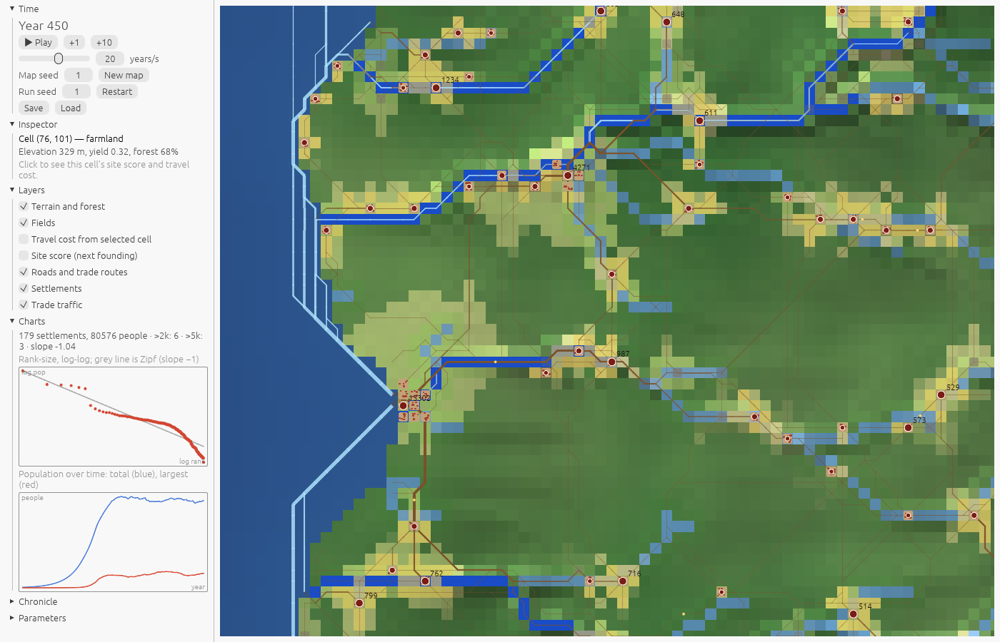

# Hinterlands

A self-running regional simulator. Given a map with terrain, water and resources and a few starting hamlets, it shows where settlements grow, shrink, appear and die over five centuries, and where fields are cultivated. Pre-industrial throughout: foot, cart, river boat and sailing ship. Rust, compiled to WebAssembly for the browser.

The brief is [`docs/foundation.md`](docs/foundation.md). Departures from it are in [`docs/decisions.md`](docs/decisions.md), the exact validation definitions in [`docs/validation.md`](docs/validation.md), and the record of each milestone, with its numbers, in [`docs/milestones.md`](docs/milestones.md).

## Running it

```sh
just web            # build the browser app into dist/ (needs trunk and the wasm32 target)
just serve          # build and serve on http://localhost:8080
just run            # one 500-year headless run, metrics every 50 years
just test           # unit tests, determinism and the golden snapshot hash
just validate       # the validation table: 3 maps x 20 seeds x 500 years
just real           # the real-terrain test on Kent (20 seeds, scored against the towns of c.1300)
```



In the browser: press **Play**. The map fills in year by year. Click a cell to pin it in the inspector; drag to pan, scroll to zoom. The left panel has time controls and seeds, the inspector, layer toggles (including the travel-cost and site-score overlays), charts (rank-size and population), the chronicle of foundings and failures, and every model parameter as a slider. **Save** downloads the run (seeds, parameters and year); **Load** replays it exactly. Names label settlements (revealed by rank as you zoom), rivers, ranges, seas, bays and forests; each class has its own toggle, and the legend lists the symbols of the layers that are on. Close up, the 1.x layers draw the countryside and towns from the same snapshot: field strips with a three-field fallow rotation, the clearing frontier, pasture and coppice woodland, hedgerows and the ghost patterns of abandoned fields, footpaths, parish boundaries, hearth and charcoal smoke, seasons (spring high water, winter frost, ships in port), and site-earned buildings: churches, market squares, cathedrals, walls, water mills, quays and warehouses, and bridges where a crossing is busy. The page address takes `?map=N`, `?seed=N` and `?year=N` to open a given run at a given year, `?on=a,b` and `?off=a,b` to switch layers by id, `?season=0..3` to fix the season, and `?selftest=N` to log the snapshot hash and the time per year (compare with `hinterlands hash --years N`).

## The model in one page

The world is a grid of 1 km cells (128 × 128 by default) generated from a seed: relief, thermal erosion, stream-power incision, drainage with navigable rivers, fords and harbours, soil yield and natural forest. Settlements are points with one population number. Each year runs six systems in a fixed order.

**Travel cost** (Tobler 1993; ORBIS). Every move costs km-equivalents: land 1.0 per km scaled by Tobler's slope factor, road 0.5, river 0.2 downstream and 0.4 upstream, sea 0.08. Fixed costs apply for crossing a river away from a ford (5), stepping between land and boat (3, doubled on open coast), and moving cargo between river barge and sea ship at a mouth (2). Ports, heads of navigation and fords appear as cost minima without special rules. Each settlement keeps its least-cost paths to every other settlement within cost 30.

**1. Cultivation** (von Thünen; VEP). A settlement claims free cells in order of walking cost, within a cultivation radius, until its harvest, less what it sends to market, covers its need with a margin. It releases its farthest cells when it needs fewer. Fields lose their forest; fuel is cut nearest first; abandoned land regrows. One prime cell feeds 150 people.

**2. Trade** (Wilson 1970; Rihll & Wilson 1987; Barjamovic et al. 2019). Each settlement sends a fixed share of its harvest (rents, tithes, sales), plus any resource output, to its partners in proportion to `W_j^α · exp(−β·c_ij)`. `W_j` is the settlement's non-farming population: people beyond what its own harvest feeds. Food arrives less a loss per unit cost. Flows are laid on the stored paths, giving route loads and route junctions (hubs).

**3. Growth.** Villages grow by natural increase when they have a surplus, at most `r_grow` a year, and shrink when short of food. Towns grow by the Rihll–Wilson term `ε(D − K·W)`, where `D` is net food imports, and the people come as migrants from their partners. A small place near a much larger one loses people to it (the urban shadow).

**4. Founding** (Bosker & Buringh 2017; Christaller; Bleakley & Lin 2012). Every five years every free cell with water nearby and no settlement within 3 km is scored for transport (hub, navigable river, coast, road), free food nearby, the shadow of larger neighbours and access to markets beyond it, plus noise. The best few become hamlets, peopled from the nearest well-fed settlement.

**5. Failure.** A settlement below 20 people for 10 years, or unfed for 20, is removed; its fields are released and its people move to the nearest fed settlement. Most new foundations fail; the well-placed survive.

**6. Roads** (Dalgaard et al. 2022). Every ten years the largest trade flows whose path is not yet road become roads, and travel costs are rebuilt.

**Names.** Settlements are named when founded, and natural features when the map is generated, from a hash of the place and its features (-ford at a ford, -mouth at a river mouth, -port on a harbour, -hurst in woodland, -don on high ground). Naming never touches the run's random generator.

Everything drawn on screen (footprints, routes, trade traffic, labels, overlays, charts) is derived from the year's snapshot and never feeds back.

## Validation

v1 passes when every check in [`docs/validation.md`](docs/validation.md) holds in at least 75% of 20 seeds on each of three generated maps, the aggregate checks (contingency, median count over 5,000) pass on each map, and runs are deterministic. Current results are in [`docs/milestones.md`](docs/milestones.md). Known limit: trade has one tier with one distance decay, so it gives regional markets but little long-distance transfer traffic; the largest city sits on the main river corridor or the coast rather than at the main mouth (see D20).

**Real terrain.** v1 was also run unchanged on real elevation for Kent and the lower Thames and scored against the 70 towns of c.1300 (`just real`; report in [`docs/real-terrain.md`](docs/real-terrain.md)). It finds the ports and river towns but places inland market towns no better than chance, and London does not form without long-distance trade.

**Determinism.** A run is fixed by `(map seed, run seed, parameters)`. The same inputs give a bit-identical final snapshot natively and in the browser; `cargo test` checks the golden hash.

## Parameters

Every parameter, with its default, range and meaning, is printed by `cargo run --release -p hinterlands-cli -- params`. The table is in [`docs/parameters.md`](docs/parameters.md).

## Layout

| Crate | Contents |
| --- | --- |
| `hinterlands-core` | `Terrain`, `State`, `Params`, `Snapshot`, the six systems, metrics, inspector queries. No I/O. |
| `hinterlands-mapgen` | Map generation as a pipeline of passes; ESRI ASCII DEM import with edge inflows. |
| `hinterlands-cli` | `run`, `validate`, `sweep`, `search`, `render`, `bench`, `hash`, `params`, ground-truth scoring. |
| `hinterlands-web` | The egui viewer: `SimHandle`, `ViewState`/`Msg`, layers and panels. |
