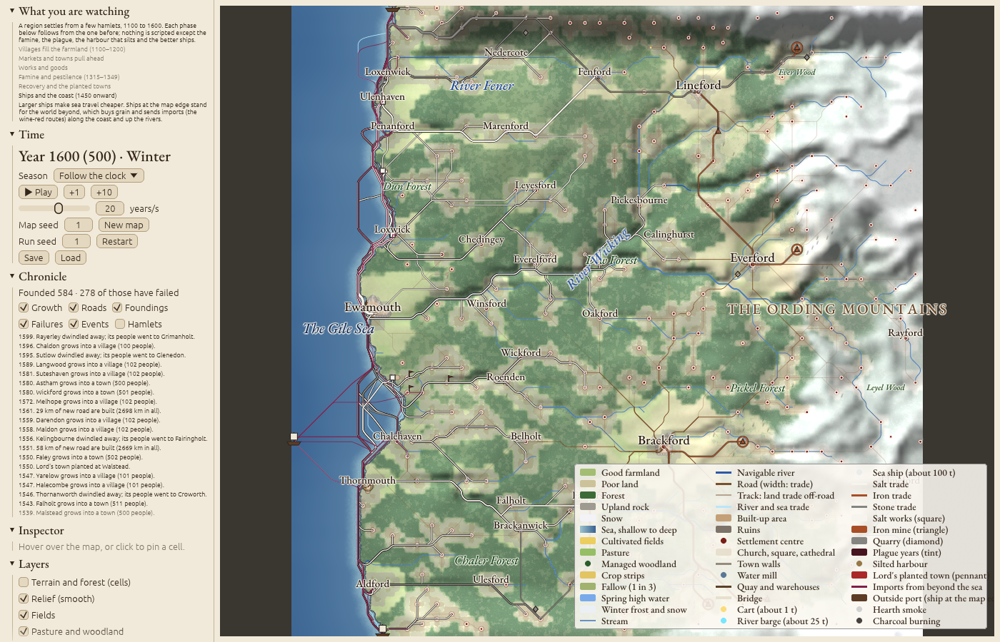

# Hinterlands

A self-running regional simulator. Given a map with terrain, water and resources and ten starting hamlets, it shows where settlements are founded, grow, shrink and die over five centuries, 1100 to 1600: fields, markets, roads, works, famine and plague, and trade with the world beyond the sea. Pre-industrial throughout: foot, cart, river boat and sailing ship. Rust, compiled to WebAssembly for the browser.

The brief is [`docs/foundation.md`](docs/foundation.md). Departures from it are in [`docs/decisions.md`](docs/decisions.md), the validation definitions in [`docs/validation.md`](docs/validation.md), each milestone's numbers in [`docs/milestones.md`](docs/milestones.md), and every parameter in [`docs/parameters.md`](docs/parameters.md).



## Running it

```sh
just web            # build the browser app into dist/ (needs trunk and the wasm32 target)
just serve          # build and serve on http://localhost:8080
just run            # one 500-year headless run, metrics every 50 years
just test           # unit tests, determinism and the golden snapshot hash
just validate       # the acceptance test: 3 maps × 20 seeds × 500 years
just real           # the Kent regression, scored against the towns of c.1300
```

In the browser, press **Play**. The **What you are watching** panel says what each phase of the run shows. The other controls:
- **Map:** drag to pan, scroll to zoom. Hover over a place for a card; click to pin it in the inspector.
- **Panels:** the chronicle (with filters), charts and the event timeline, goods, and every parameter as a slider.
- **Save and Load:** Save downloads the run; Load replays it exactly.
- **Address:** `?map=N`, `?seed=N` and `?year=N` open a run at a year; `?on=a,b` and `?off=a,b` switch layers; `?selftest=N` logs the snapshot hash and the time a year.

## The model in one page

The world is a grid of cells (1 km, 128 × 128 by default), generated from a seed or imported from a real elevation model. It has relief, erosion, drainage with navigable rivers, fords and harbours, soil yield, natural forest, and salt, iron and stone sites. Settlements are points with a population and a market size. Each year runs the systems below in a fixed order, from one seeded random generator, so a run is fixed by its seeds and parameters.

| Mechanism | What it does | Source |
| --- | --- | --- |
| **Travel cost** | Each move costs km-equivalents: land with a slope factor, road, river (down and up), and sea, plus fixed costs to cross a river away from a ford, to board or leave a boat, and to transship at a river mouth. Each place keeps its least-cost paths to the places within reach. | Tobler 1993; ORBIS (Scheidel & Meeks) |
| **Cultivation** | A place claims free cells nearest first until its harvest, less what it sends to market, feeds it. Fields lose their forest; fuel is cut nearest first; abandoned land regrows. A stream among the fields gives a mill (+3%). | von Thünen 1826; Village Ecodynamics Project |
| **Production** | Salt works, iron mines and quarries are worked by the place that holds them. Iron burns coppiced charcoal from the holder's woods, capped by regrowth. | Weber 1909 |
| **Trade** | A fixed share of each harvest goes to markets in proportion to `W^α · exp(−β c)`, W being the market's size. Goods are bought by the shopping model and paid in grain. Flows ride the stored paths, and the places they pass earn a margin, more where cargo is transshipped. | Wilson 1970; Rihll & Wilson 1987; Huff 1964; Bleakley & Lin 2012 |
| **Goods by price** | Salt, iron, stone and imports trade by an entropy-regularised spatial price equilibrium: each buyer pays its own price, sites sell at a supply price, and dear goods draw new works. | Samuelson 1952; Takayama & Judge 1971; Wilson 1970 |
| **Relief and stores** | After trade, places short of food draw, unpaid, on neighbours' grain above what they can eat. Each place keeps a store of up to a year's need, filled from that surplus and losing 5% a year; it carries grain into the famine of 1315. | Clark 1999 |
| **Outside world** | One port per open-sea map edge buys a fixed amount of grain a year and is the only seller of imports, bought by market people and paid in grain. | Fujita & Mori 1996 |
| **Growth** | Villages grow by natural increase on a surplus and shed people when short. Markets grow by `ε(D − K·W)`, with migrants drawn from their partners. A small place near a much larger one is drained (the urban shadow). | Rihll & Wilson 1987; Bosker & Buringh 2017 |
| **Founding** | Every five years the free cells with water at hand are scored for free farmland, less the shadow of larger neighbours, plus market access, plus noise. The best become hamlets. A free resource site with demand in reach gets a specialist hamlet. | Artificial Anasazi (Dean et al. 2002); Christaller 1933 |
| **Failure** | An underfed place sheds the people it cannot feed. A place below 20 people for 12 years is removed. Most new foundations fail. | Village Ecodynamics Project |
| **Roads and bridges** | The busiest routes become road. A road whose traffic falls away loses condition and fades. A busy river crossing gets a bridge that never decays. | Dalgaard et al. 2022 |
| **Shocks** (calendar from 1100) | The Great Famine of 1315–17 cuts yields by 40%. The Black Death of 1348 kills about 40%, with recurrences in 1361 and 1369. Survivors then leave poor land for vacant good land. One harbour (not the largest place) silts up between 1350 and 1500, and lords plant a town every 50 years from 1250. | Jordan 1996; Benedictow 2004; Dyer; Beresford 1967 |
| **Better ships** | Sea cost per km falls by 30% between 1300 and 1500. | Unger 1980 (cog, hulk, carrack) |

Names come from a hash of the place and its features (-ford at a ford, -mouth at a river mouth), never from the run's random generator. Everything drawn on screen is derived from each year's snapshot and never feeds back.

## Validation

**The gate.** Every check in [`docs/validation.md`](docs/validation.md) must hold in at least 75% of 20 seeds on each of three generated maps, with historical events on:
- the v1 hierarchy checks: counts, rank-size slope, market spacing, failure rate, siting, forest and stability;
- goods: sites producing, and no specialist as the largest place;
- a settled road network;
- the plague's fall and recovery, the desertion of poor land, and the old hierarchy returning;
- outside trade between 3% and 20% of market inflow.

Runs are deterministic, natively and in the browser; `cargo test` checks the golden hash.

**Real terrain.** The model is also run on real elevation for Kent and the lower Thames, with Roman roads and the real salt, iron and stone sites, and scored against the 70 towns of c.1300 (`just real`; [`docs/real-terrain-experiments.md`](docs/real-terrain-experiments.md)).
- **Where it does well:** it finds the tidal ports and the river towns, and the largest city forms on the Thames estuary near Gravesend.
- **Where it falls short:** it places the small inland market towns barely better than chance, and Watling Street mostly fades, since the model carries Continental goods by sea.

## Layout

| Crate | Contents |
| --- | --- |
| `hinterlands-core` | `Terrain`, `State`, `Params`, `Snapshot`, the systems and the event queue, metrics, inspector queries. No I/O. |
| `hinterlands-mapgen` | Map generation as a pipeline of passes; ESRI ASCII DEM import with roads, soils, resources and outside ports. |
| `hinterlands-cli` | `run`, `validate`, `sweep`, `search`, `render`, `hash`, `params`, and the probes (`goods`, `roads`, `desertion`). |
| `hinterlands-web` | The egui viewer: `SimHandle`, `ViewState` and `Msg`, map layers and side panels. |
