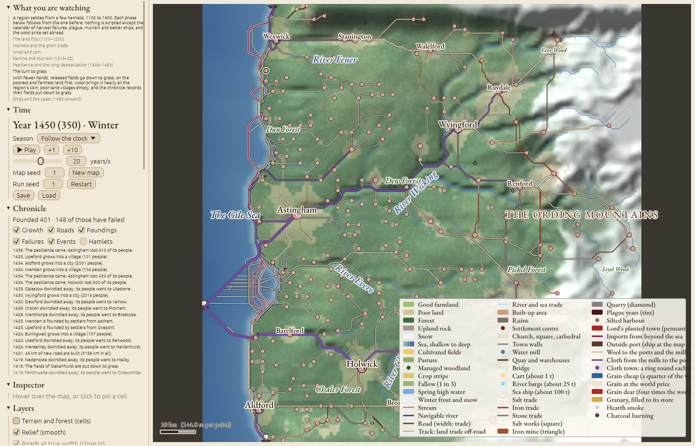

# Hinterlands

A self-running regional simulator. Given a map with terrain, water and resources and ten starting hamlets, it shows where settlements are founded, grow, shrink and die over five centuries, 1100 to 1600: fields, markets, roads, works, sheep and cloth, famine and plague, and trade with the world beyond the sea. Pre-industrial throughout: foot, cart, river boat and sailing ship. Rust, compiled to WebAssembly for the browser.

The brief is [`docs/foundation.md`](docs/foundation.md). Departures from it are in [`docs/decisions.md`](docs/decisions.md), the validation definitions in [`docs/validation.md`](docs/validation.md), each milestone's numbers in [`docs/milestones.md`](docs/milestones.md), and every parameter in [`docs/parameters.md`](docs/parameters.md).



## Running it

```sh
just web            # build the browser app into dist/ (needs trunk and the wasm32 target)
just serve          # build and serve on http://localhost:8080
just run            # one 500-year headless run, metrics every 50 years
just test           # unit tests, determinism and the golden snapshot hash
just validate       # the acceptance test: 3 maps × 40 seeds × 500 years
just real           # the Kent regression, scored against the towns of c.1300
```

In the browser, press **Play**. The **What you are watching** panel says what each phase of the run shows. The other controls:
- **Map:** drag to pan, scroll to zoom. Hover over a place for a card; click to pin it in the inspector. Hover over a ship to see that outside port's trade this year: the salt, iron and imports it supplied, and the grain, wool and cloth it bought.
- **Panels:** the chronicle (with filters), charts and the event timeline, goods, and every parameter as a slider.
- **Save and Load:** Save downloads the run; Load replays it exactly.
- **Address:** `?map=N`, `?seed=N` and `?year=N` open a run at a year; `?on=a,b` and `?off=a,b` switch layers; `?selftest=N` logs the snapshot hash and the time a year.

## The model in one page

The world is a grid of cells (1 km, 128 × 128 by default), generated from a seed or imported from a real elevation model. It has relief, erosion, drainage with navigable rivers, fords and harbours, soil yield, natural forest, and salt, iron and stone sites. Settlements are points with a population and a number of market people (W). Each year runs the systems below in a fixed order, from one seeded random generator, so a run is fixed by its seeds and parameters. Prices and money are in grain-value units: one person's grain for a year at price 1.

| Mechanism | What it does | Source |
| --- | --- | --- |
| **Travel cost** | Each move costs km-equivalents: land with a slope factor, road, river (down and up), and sea, plus fixed costs to cross a river away from a ford, to board or leave a boat, and to transship at a river mouth. Each place keeps its least-cost paths to the places within reach. | Tobler 1993; ORBIS (Scheidel & Meeks) |
| **Cultivation** | A place claims free cells nearest first until its harvest, after rent, feeds its farmers. Fields lose their forest; fuel is cut nearest first; abandoned land regrows. A stream among the fields gives a mill. | von Thünen 1826; Village Ecodynamics Project |
| **Weather** | Each cell's harvest varies year to year with a spatially correlated shock (about 15 km, sd 15%). | Clark (yields on 65 manors) |
| **Marketplaces** | Rent (35% of the harvest) and the farmers' surplus go to markets by `W^α · exp(−β c)`. Large markets trade grain among themselves at prices that clear by an entropy-regularised spatial equilibrium, with a toll to the market. Market people buy within their purse, their food first and their establishment (malt, fodder) giving way first in dearth. W grows on the grain a market draws from other places. | Christaller 1933; Wilson 1970; Samuelson 1952; Clark 1999 (price dispersion, R²) |
| **Money** | Every place holds two purses: the farmers' and the market's (lords, church, merchants). Grain and goods are paid in coin. Unspent coin recirculates (farmers spend at their markets, markets on the farmers they buy from); luxuries bought abroad and coin wear leave the region. Coin enters through the ports' payments for grain and wool, so the price level is set by price-specie flow. Coin is conserved exactly (a unit test). | Mayhew 1995; Hume 1752; Dyer 1989; Britnell 1993 |
| **Stores** | Large markets keep a store, buying below their ten-year average price less a holding margin and selling into a price spike. Villages short of grain buy with their purse; relief and village stores are unpaid. | Williams & Wright 1991; Clark (carry-over) |
| **Goods** | Salt, iron, stone and imports trade by the same price equilibrium; each buyer pays its own price, sites sell at a supply price, and dear goods draw new works. Iron burns coppiced charcoal. Demand comes from stocks: salt by the head (15 lb a year), iron for households, ploughs and works, and stone to repair what is built (2% a year) and to build as markets grow. The outside ports sell salt and iron as well as imports, and a place with no port in reach still buys from its nearest port at the full carriage. | Weber 1909; Takayama & Judge 1971; Dyer 1989 |
| **Wool and pasture** | Free land within reach that is not worth ploughing at its distance (its net grain would feed fewer than the people it takes to work) goes to grass: poor and far land first. A km² carries about 370 sheep, and a sheep is folded on each fallow acre of the three-field arable. The clip sells at the outside ports at £5 a sack in 1294, moving with Clark's wool price against wheat by decade, or to households for home cloth (1.5 yards an adult) and to the mills. The coin is split by the rent share. Shepherds count with the farmers. | von Thünen 1826; Lloyd 1973; Clark 2004; Campbell 2000; Dyer 1989 |
| **Cloth** | A market place with a water mill (a stream among its fields) fulls cloth for export: it buys wool at a clearing price and sends broadcloth to the ports, at about £2 a cloth of 84 lb of wool (5.7 d a lb) before 1450 and on Munro's customs values against Clark's wheat after it; making costs 2.7 d a lb. A mill's capacity grows with its market people, so the industry grows as the cloth margin grows its towns. The mills pay their wool from the cloth's proceeds. | Munro (customs valuations; Ypres and Leuven costs); Carus-Wilson (fulling mills); Clark 2004 |
| **Outside world** | One port per open-sea map edge buys grain below the world price and wool at its price, and sells imports. | Fujita & Mori 1996 |
| **Growth** | Villages grow by natural increase on a surplus. A shortfall stops growth; only a shortfall below 80% of need sheds people. Markets grow by `ε(D − K·W)`, with migrants drawn from their partners; a small place near a much larger one is drained (the urban shadow). | Rihll & Wilson 1987; Livi-Bacci 1991; Bosker & Buringh 2017 |
| **Founding and failure** | Every five years the free cells with water at hand are scored for farmland, market access and the shadow of larger neighbours; the best become hamlets, and specialist hamlets go to free resource sites. A place below 20 people for 12 years is removed; most new foundations fail. | Artificial Anasazi (Dean et al. 2002); Village Ecodynamics Project |
| **Roads and bridges** | The busiest routes become road; a road whose traffic falls away fades. A busy river crossing gets a bridge. | Dalgaard et al. 2022 |
| **The historical calendar** (from 1100) | The Great Famine takes 40%, 60% and 10% of yields in 1315–17; scab and murrain cut wool by 15% in 1315–22 and 10% in 1323–32. The Black Death of 1348 kills about 40%, with recurrences in 1361, 1369 and ten more to 1479, and endemic disease takes 1.5% a year from 1349 to 1480, so the region holds about half its 1340 people in 1450. (A calendar with each later outbreak's sourced mortality is built and parked, D178.) One harbour silts up; lords plant towns from 1250; sea costs fall 30% from 1300 to 1500. | Jordan 1996; Slavin 2020; Benedictow 2004; Hatcher 1977; Beresford 1967; Unger 1980 |

Names come from a hash of the place and its features (-ford at a ford, -mouth at a river mouth), never from the run's random generator. Everything drawn on screen is derived from each year's snapshot and never feeds back. The inspector shows each place's grain price, purses and market store, its wool sold and, at a cloth town, the wool it made into cloth and the cloth's margin. The **Grain prices** layer colours places from cheap to dear against the world price; the **Wool and cloth** layer draws wool to the ports and the mills in fleece cream, export cloth from the mills to the ports in violet, and a violet ring round each main cloth town.

## Validation

**The gate.** Every check in [`docs/validation.md`](docs/validation.md) must hold in at least 30 of 40 seeds on each of three generated maps, with historical events on:
- the hierarchy: settlement count, over 5,000, largest share, rank-size slope, failure rate, siting, forest near cities and stability;
- goods: sites producing, every good worked, and no specialist as the largest place;
- the plague: its fall, recovery to at least 0.75 of the pre-plague peak by 1600, the desertion of poor land, and the old hierarchy returning;
- outside trade: exports (grain, wool and cloth by value added) between 1% and 35% of the region's output in 1600, against England's 6–7% c. 1300 (Broadberry et al. 2015);
- Clark's tests on grain prices (`b_P` 0.8–1.2, `b_Y` −0.15–0, R² ≥ 0.6), unsold grain under 10%, and the price level between 0.3 and 2.5 at every 50-year mark;
- pasture outward and on poor land, and more pasture in 1450 than in 1340.

**Two checks are paired** against the accepted default on the same 40 seeds until their bands are sourced: market spacing (the median nearest-neighbour distance among market places) and road persistence (the share of year-300 road still on a road, within two cells, at year 500). A change passes them if it is no worse than the default by more than two runs (D176).

**Reported against history, not gated:** places over 2,000 and the urban share (England about 0.10); recovery against the record's 0.85 of the peak and a ceiling of 1.15; the famine dip; wool's share of coin entering; exports a head (England about 14 d c. 1300); and store carry-over. The cloth share of wool leaving is traced by `hinterlands clothpace`. Runs are deterministic, natively and in the browser; `cargo test` checks the golden hash and the conservation of coin.

**Known misses** (`docs/decisions.md`):
- The region recovers too fast after 1480, to 1.2–1.3 times its pre-plague peak by 1600 against England's 0.85 (D172). Its cause is that one growth rate serves both the frontier and the recovery; separating them is the next piece of work.
- The cloth share of wool leaving reaches the record's level about 40 years late (D144).

**Real terrain.** The model is also run on real elevation for Kent and the lower Thames, with Roman roads and the real salt, iron and stone sites, and scored against the 70 towns of c.1300 (`just real`; [`docs/real-terrain-experiments.md`](docs/real-terrain-experiments.md)).
- **Where it does well:** it finds the tidal ports and the river towns, and the largest city forms on the Thames estuary near Gravesend.
- **Where it falls short:** it places the small inland market towns barely better than chance, Watling Street mostly fades, and Kent's soil layers lack the chalk and marsh that made the Downs and Romney Marsh sheep country.

## Layout

| Crate | Contents |
| --- | --- |
| `hinterlands-core` | `Terrain`, `State`, `Params`, `Snapshot`, the systems and the event queue, metrics, inspector queries. No I/O. |
| `hinterlands-mapgen` | Map generation as a pipeline of passes; ESRI ASCII DEM import with roads, soils, resources and outside ports. |
| `hinterlands-cli` | `run`, `validate`, `sweep`, `search`, `render`, `hash`, `params`, `bench`, and the probes (among them `goods`, `roads`, `desertion`, `prices`, `money`, `wool`, `cloth`, `clothpace`, `demand`, `outside` and `towns`). |
| `hinterlands-web` | The egui viewer: `SimHandle`, `ViewState` and `Msg`, map layers and side panels. |
