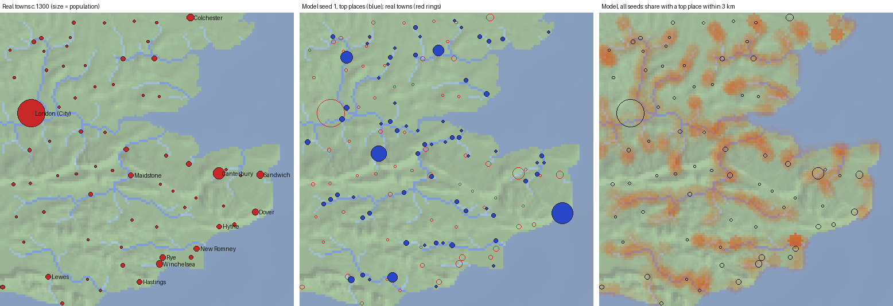

# Real-terrain test: Kent and the lower Thames

The foundation calls a run on real terrain, compared with the towns that actually grew there, "the single most valuable step after v1". This is that test. v1 was run unchanged (default parameters, no re-tuning) on real elevation for Kent and the lower Thames, and compared with the towns of c.1300.

## Summary

- **The model has a little skill, and almost all of it comes from water.** Its larger places sit on navigable rivers and estuaries, so it finds the real ports and river towns: New Romney 95% of seeds, Gravesend 80%, Canterbury and Rochester 75%, Maidstone and Faversham 65%. For the 27 towns of 1,000 or more, the 20-seed frequency map rates the real sites above random land (AUC 0.63, or 0.68 away from the map edge). The real top 10 have a model top-15 place within 10 km 43% of the time, against 29% for random placement.
- **Beyond "low ground near navigable water", it has no skill at placing towns.** Compared with random *lowland* cells, the AUC falls to 0.48 for all towns and 0.54 for the larger ones. Recall and precision of the model's top 70 against the 70 real towns equal random placement (0.37 against 0.37 within 5 km). Rank agreement is near zero (Spearman 0.08).
- **The miss is the inland market town.** Two thirds of real towns are inland: market and road towns along the London roads, the Downs spring line and the Weald. The model puts half its places on navigable rivers (49%, against 26% of real towns), finds 63% of the real river towns and only 29% of the inland ones. Real towns are also more evenly spaced than the model's (nearest neighbour 8.6 km, against 7.1 for the model and 6.9 for random points): the regular market spacing of Christaller is visible in the real map and not in the model's.
- **London does not form.** The largest model city sits at an estuary mouth in most seeds (Blackwater/Crouch, the Thames mouth, Dover), as the break-of-bulk rule (D18) favours. A place near London's site is second-largest in only 2 of 20 seeds; in most seeds it is a hamlet. Real London stood at the tidal head and the first bridge, and grew on trade from beyond the region. That is the long-distance tier v1 leaves out (D20).
- **The result is robust.** It barely moves when the navigable-river threshold is quadrupled (AUC 0.56, 0.65 and 0.51 against 0.57, 0.63 and 0.53), or when everything within 10 km of the map edge is left out.



*Left: real towns c.1300, sized by population. Middle: the model's top 70 places in seed 1 (blue) over the real towns (red rings). Right: the share of the 20 seeds with a top-70 model place within 3 km (orange), with the real towns as rings. The orange follows the river network; the rings are spread across the land.*

## What this means for v2

v2 as planned adds goods and specialists: mining and salt towns, and Weber's rule for where processing happens. That would add more point-site towns. It would not fix the main miss, which is the ordinary inland market town. Two cheap experiments on this map, each behind a toggle that defaults off and each scored with this same test, would tell us more first:

1. **The outside world** (allowed by D20): a sea market off the estuary mouth with its own low β. The test is whether a London-sized city forms at the head of the estuary, not at the mouth. Real terrain gives the experiment a clear target it lacked on generated maps.
2. **Market spacing for inland towns.** Inland market towns in England sat about one day's return walk apart: roughly 10–12 km, the distance behind the medieval legal rule against new markets within 6⅔ miles of an existing one. The model has no market function as such: founding scores transport and food, and growth comes from food trade, so an inland place without water or a hub has nothing to grow on. A market term in growth or founding, based on the cultivated hinterland within walking range and not on through-trade, is the smallest change that could produce them. A related input-data option: Roman roads as a given network at the start (Watling Street, Stane Street), which v1 builds only from trade.

Soil is the third missing input. This test used uniform soil because no soil map was loaded. The Weald clay, the chalk Downs and the Thanet loams differ a great deal, and a soil layer from a published soil map could be added to the importer as a raster.

My recommendation: run experiments 1 and 2 on Kent, then plan v2 with the results. If the market term recovers the inland towns, it belongs in v2 ahead of goods.

## Setup

| | |
| --- | --- |
| Region | lon −0.29 to 1.55, lat 50.76 to 51.911: 128 × 128 km at 1 km cells (`data/real/kent/region.json`) |
| Elevation | SRTM 3″ via the AWS Terrarium tiles (zoom 10, about 95 m), averaged into 1 km cells (`tools/real/fetch_dem.py`) |
| Thames | 9,950 km² of drainage (the catchment at Teddington) enters at the west edge near Kew (`inflows` in `data/real/kent/map.json`, D23) |
| Soil, forest | Uniform (`soil_noise` and `forest_noise` 0), since no soil map is loaded |
| Model | v1 defaults, unchanged; run seeds 1–20; 500 years from the 10 starting hamlets |
| Truth | 70 towns c.1300 (`data/real/kent/towns.csv`): city, borough, Cinque Port or market town with urban character. London is one entry (80,000) covering Southwark and Westminster |
| Comparison | The model's top 70 places against the 70 real towns, so the model's absolute population scale does not matter; and its top 27 against the 27 real towns of 1,000 or more |
| Baselines | The same places dropped on random land cells, and on random lowland cells (under 50 m); 200 draws per seed |

**Caveats.**
- The town list is compiled, not taken from one source. Only London, Canterbury, Colchester and Rochester have published figures (1377 poll tax, Dyer 2000; Keene for London). The other 66 populations are tier estimates (borough or port 1,500–3,000, market town 600–1,200, small market town 400–600). Coordinates are from Wikipedia. Status is borderline for about 16 of the small towns, and the market-grant dates in the notes were not checked against the Gazetteer of Markets and Fairs. The rank test inherits this uncertainty; the location tests mostly do not.
- The coastline is today's. In 1300 the Wantsum Channel still cut off Thanet (the model's persistent place near Sarre, 105, 60, falls on a real medieval Wantsum port), Romney Marsh was only partly drained, and Winchelsea and New Romney had harbours that later silted.
- Edge effects: London, Colchester and Croydon lie near the box edge, so their catchments are cut. Leaving out a 10 km border changes little (`docs/real/kent/interior/scores.md`).
- At 1 km cells, rivers narrower than a cell are lines in the cost graph, which is how the model treats rivers anyway.

## Results

All 70 towns against the model's top 70 (20 seeds, year 500):

| Measure | Model | Random land | Random lowland |
| --- | ---: | ---: | ---: |
| Real towns with a model place within 5 km | 0.37 | 0.37 | 0.30 |
| Real towns with a model place within 10 km | 0.82 | 0.82 | 0.65 |
| Model places with a real town within 5 km | 0.43 | 0.41 | 0.38 |
| Real top 10 with a model top-15 place within 10 km | 0.43 | 0.29 | 0.38 |
| Rank agreement (Spearman) | 0.08 | −0.03 | 0.20 |

Site prediction over all 20 seeds (AUC: the chance that a real town's cell scores above a random cell; 0.5 is no skill):

| Towns | AUC against land | AUC against lowland |
| --- | ---: | ---: |
| All (70) | 0.57 | 0.48 |
| 1,000 or more (27) | 0.63 | 0.54 |
| Under 1,000 (43) | 0.53 | 0.44 |

By site (navigable river within a cell, else coast, else inland):

| Site | Real towns | Model top places | Real towns found within 5 km |
| --- | ---: | ---: | ---: |
| River | 18 (26%) | 49% | 63% |
| Coast | 6 (9%) | 13% | 22% |
| Inland | 46 (66%) | 38% | 29% |

The full tables are in [`real/kent/scores.md`](real/kent/scores.md): per seed, each town's find rate, and the persistent model places with no real town nearby. The interior-only scores are in [`real/kent/interior/scores.md`](real/kent/interior/scores.md), and the stricter-navigation sensitivity case in [`real/kent/sensitivity-nav800.md`](real/kent/sensitivity-nav800.md).

The towns found most often (share of seeds with a model place within 5 km): New Romney 95%, Hailsham 90%, Gravesend and Hatfield 80%, Canterbury, Rochester, Pevensey and Coggeshall 75%, Milton Regis 70%. Never found: Colchester (on the map's edge), Battle, East Grinstead, Tenterden, Cranbrook, Romford, Braintree, Brentwood, Chipping Barnet and Bletchingley. Westerham, Wrotham, Lenham and Elham were also never found. These are Wealden cloth and market towns, and road towns on the London roads and the Pilgrims' Way.

## Reproducing

```sh
python3 -I tools/real/fetch_dem.py -0.29 50.76 1.55 51.911 128 128 data/real/kent/kent.asc   # already committed
just real                                 # 20 seeds, then scores and figures into docs/real/kent
```

`hinterlands run --dem FILE --map-params FILE --towns out.csv --cells out.csv` writes one run's settlements and the cell classes; `tools/real/score.py` does the scoring. A new region needs `region.json`, the `.asc`, a `map.json` (with inflows where a big river enters across the edge) and a `towns.csv`.
